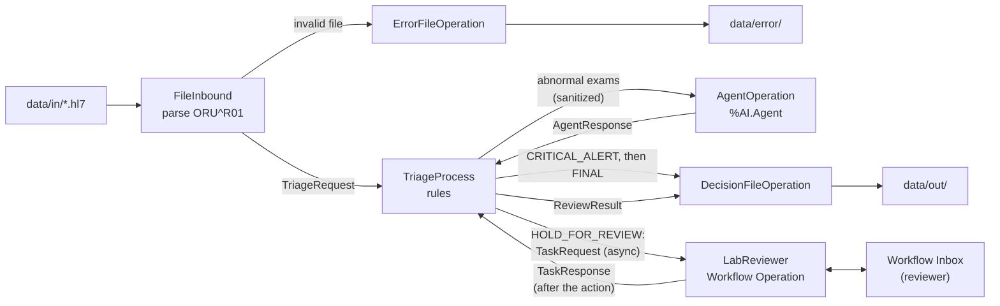

# LabTriage Agent

Entry for the InterSystems Developer Community contest **"AI Agents in Interoperability Workflows"** (2026).

Triage of HL7 v2 ORU^R01 lab results on InterSystems IRIS for Health Interoperability.
Deterministic rules decide CRITICAL. An AI agent (`%AI.Agent`, AI Hub SDK) explains the abnormal
results and decides RELEASE or HOLD_FOR_REVIEW. The most severe decision of the message wins.

All data in this repo is synthetic. The critical limits are fictional. Not for clinical use.

Article on the Developer Community: [Rules First, Model Second, Human Last: Triaging HL7 v2 Lab Results with an AI Hub Agent](https://community.intersystems.com/post/rules-first-model-second-human-last-triaging-hl7-v2-lab-results-ai-hub-agent)

## Demo video

[](https://youtu.be/d4WxXiQP5_Y)

## Community Idea implemented

[DPI-I-689: Use InterSystems Interoperability as a Traceability tool for GenAI LLM pipelines](https://ideas.intersystems.com/ideas/DPI-I-689)

Every LLM call of the production is an Interoperability message: the TriageProcess sends an `AgentRequest` to the
`AgentOperation`, the only component that talks to the LLM provider, and gets an `AgentResponse` back. Each call is
therefore persisted in the message store and shown in Visual Trace, in the same session as the lab result
(`TriageRequest`), the triage output and, for held messages, the review task. No separate tracing SDK or service is
involved.

Metadata visible in Visual Trace:

| Metadata | Where |
|---|---|
| Prompt version | `AgentResponse.PromptVersion` |
| Input / output tokens | `AgentResponse.InputTokens`, `AgentResponse.OutputTokens` |
| Latency | `AgentResponse.LatencyMs` (per call), `TriageResponse.AgentLatencyMs` (sum of the calls) |
| Attempts | `AgentRequest.Attempt` (one message per attempt), `TriageResponse.AgentAttempts` |
| Fallback | Per exam in the `TriageResponse`: `DecidedBy = FALLBACK`, `ReasonCode = AGENT_FALLBACK`; `AgentStatus` says why |

Vector Search is not used: the idea suggests it, but it is not required.

See [Reproducible example: LLM traceability in Visual Trace](#reproducible-example-llm-traceability-in-visual-trace).

## Comparison with Langfuse

| Aspect | Langfuse | LabTriage Agent (IRIS Interoperability) |
|---|---|---|
| How calls are captured | SDK / OpenTelemetry instrumentation in the application code, sent to a separate Langfuse backend | Each LLM call is already an Interoperability message (`AgentRequest` → `AgentResponse`); no extra SDK or service |
| Where trace data lives | Langfuse Cloud or a self-hosted multi-service deployment | The same IRIS instance and message store as the production |
| Trace view | Nested tree of spans with timing, tokens and cost per node | Visual Trace sequence diagram between business hosts; metadata in the message Body |
| Tokens and cost | Input/output tokens; cost computed automatically from model price definitions; dashboards | Input/output tokens and latency per successful call; no cost calculation or dashboards |
| Prompt versioning | Full prompt management: versions, labels (staging/production), rollbacks, diffs, linked to traces | `PromptVersion` compiled into the agent class and stored on every response that used the prompt (REAL calls and replayed recordings); changing a prompt is a code change |
| Retries and fallback | Captured as generic spans if instrumented | Business-level: each attempt is its own `AgentRequest` with `Attempt`; a retry after a contract violation also carries the rejected answer and the violation. Fallback is recorded per exam (`DecidedBy = FALLBACK`) |
| Evaluation | LLM-as-a-Judge, annotation queues, custom scores | No quality evaluation: every answer is validated against a fixed contract (`AgentContract`), and held results go to human review through a Workflow task in the same session |
| Link to the business flow | Needs IDs/metadata to correlate traces with business events | The LLM call sits in the same session as the triage request built from the HL7 message, the triage response sent to the decision file operation and, for held results, the review task |
| Licensing / hosting | MIT core, self-host or Cloud; enterprise add-ons under a commercial license | Nothing beyond IRIS itself |

Langfuse is the better choice for teams that need evaluation pipelines, cost dashboards and prompt management across many LLM applications. The LabTriage approach fits a narrower but common case: the LLM is one step inside an interoperability workflow, and the goal is to see that step in the same trace, database and tooling as the rest of the message flow, with no extra service to deploy. The two are not mutually exclusive.

## Prerequisites

| Requirement | Version | Get it | Check |
|---|---|---|---|
| Git | any | [git-scm.com/downloads](https://git-scm.com/downloads) | `git --version` |
| Docker Engine or Docker Desktop | 24+ | [docs.docker.com/get-docker](https://docs.docker.com/get-docker/) | `docker --version` |
| Docker Compose | v2.24+ (`env_file` uses `required: false`) | included with Docker Desktop | `docker compose version` |
| x86_64 host | the image is linux/amd64 only; Apple Silicon runs it emulated | — | `uname -m` |
| AI Hub EAP access and the base image | build 2026.3.0AI.154.0 | see [Base image](#base-image) | `docker image ls` |
| bash and python3, for `tests/e2e/` | any (jq optional) | — | `python3 --version` |
| Ports 52773 and 1972 | must be free | — | — |
| IPM client (**Optional**) | 0.9+ | only to install with IPM; see [Install with IPM](#install-with-ipm) | `zpm "version"` (in the IRIS terminal) |
| Gemini API key (**Optional**) | `GOOGLE_API_KEY`, only for REAL mode; the default REPLAY mode runs without a key | see [LLM provider](#llm-provider) | — |

## Base image

This app was built and tested on the AI Hub Early Access build **2026.3.0AI.154.0** (IRIS for Health Community,
`Build 154U`), set in line 1 of the `Dockerfile` (`ARG IMAGE=irishealth-community:2026.3.0AI.154.0`).

> The EAP portal now also offers 2027.1 (Community build 109). The organizers said the judges will load the build
> that matches each app; for this app, that is 2026.3.0AI.154.0.

The contest rules require this base image, and no public registry has it. Load it once:

1. Download `irishealth-community-2026.3.0AI.154.0-docker.tar.gz` (x64) from the InterSystems AI Hub
   Early Access Program (EAP) portal.
2. Load and retag it:

```bash
docker image load -i irishealth-community-2026.3.0AI.154.0-docker.tar.gz
docker tag docker.iscinternal.com/docker-intersystems/intersystems/irishealth-community:2026.3.0AI.154.0 \
  irishealth-community:2026.3.0AI.154.0
```

## Quick start

```bash
git clone https://github.com/AzizCotrim/iris-lab-triage-agent.git
cd iris-lab-triage-agent
docker compose up -d --build
```

- The first build takes 4 to 6 minutes, depending on the machine; the container is healthy 1 to 2 minutes after it starts.
- The production `LabTriage.Production` starts on its own when the container starts (1 to 2 minutes in REPLAY mode).
- `docker compose ps` shows `iris` as `healthy` once the production is running.
- You don't need a `.env` file: the default mode is REPLAY (recorded LLM answers, no API key).

## LLM provider

Gemini through the AI Hub SDK, model `gemini-3.5-flash-lite` by default.

To use the real model:

```bash
cp .env.example .env
# set GOOGLE_API_KEY=<your key> and LABTRIAGE_AGENT_MODE=REAL
docker compose up -d
```

`LABTRIAGE_MODEL` (optional) changes the model without a recompile.

Agent modes (`LabTriage.Operation.AgentOperation`):

| Mode | What it does |
|---|---|
| REAL | Calls Gemini. Records every OK answer in `data/replay/`. |
| SIMULATION | Never calls the provider. Returns the outcome in the `SimulatedOutcome` setting (`HOLD_ALL`, `RELEASE_ALL`, `TIMEOUT`, `INVALID`, ...). |
| REPLAY | Returns the answer recorded for the same prompt version and the same input. With no recording, the exams fall back to HOLD_FOR_REVIEW. |

Which mode runs: the `Mode` setting of AgentOperation, if set. Otherwise `LABTRIAGE_AGENT_MODE`. Otherwise REPLAY.

Note: REAL mode rewrites `data/replay/` on every OK answer. Run `git restore data/replay` after a REAL run.

## Verify it works

**One sample by hand:**

```bash
cp data/samples/13-critical-and-abnormal.hl7 data/in/
# a few seconds later:
ls data/out/*/
cat data/out/CRITICAL/SYN-ORU-0013.final.json
```

**All 20 samples** (needs python3). The script sets Mode=REPLAY, **deletes the files in `data/out` and `data/error`**,
drops every sample into `data/in` and checks each result (about 1 minute):

```bash
tests/e2e/samples.sh
```

**Human review** (needs python3): completes the open review tasks, then sends samples 06 and 02 through the Workflow
review (Release and KeepOnHold) and checks the tasks and the `.review.json` files (about 30 seconds). It also
**deletes the files in `data/out` and `data/error`**:

```bash
tests/e2e/workflow.sh
```

**Unit tests** (96 `%UnitTest` tests):

```bash
docker compose exec -T iris iris session IRIS -U IRISAPP <<'EOF'
Set ^UnitTestRoot="/home/irisowner/dev/tests/UnitTest"
Do ##class(%UnitTest.Manager).RunTest("LabTriage","/recursive/nodelete")
Halt
EOF
```

**Management Portal:** http://localhost:52773/csp/sys/UtilHome.csp, user `SuperUser`, password `SYS`
(local dev credentials).
Production page: http://localhost:52773/csp/healthshare/irisapp/EnsPortal.ProductionConfig.zen?PRODUCTION=LabTriage.Production

## Install with IPM

The app is also an IPM module (`module.xml`, `iris-lab-triage-agent` 1.0.1).

> **Only on the AI Hub EAP image `2026.3.0AI.154.0` (build 154).** The classes use `%AI` (AI Hub SDK), which no other
> IRIS build has, so they do not compile anywhere else. The module requires IRIS `>=2026.3` and a namespace with
> Interoperability enabled.

**Namespace:** any namespace with Interoperability enabled. In the base image, `USER` already has it (no extra step).
In this repo's container, use `IRISAPP`; the module path in step 3 is `/home/irisowner/dev`. Run the steps below in that
namespace.

The build 154 image does not ship the IPM client (no `dist/install/misc/zpm.xml`; the `%IPM` classes in `HSLIB` are
HealthShare's own, not a `zpm` command).

**1. Install the IPM client** in the current namespace, with a user that has the `%ALL` role:

```
s version="latest" s r=##class(%Net.HttpRequest).%New(),r.Server="pm.community.intersystems.com",r.SSLConfiguration="ISC.FeatureTracker.SSL.Config" d r.Get("/packages/zpm/"_version_"/installer"),$system.OBJ.LoadStream(r.HttpResponse.Data,"c")
```

**2. Enable the community registry** (IPM 0.9+ has none by default; `zpm "install"` needs it):

```
zpm
repo -r -n registry -url https://pm.community.intersystems.com/ -user "" -pass ""
```

The first line opens the IPM shell; `quit` leaves it.

**3. Install the app.** From the community registry (version 1.0.1 is published):

```
USER>zpm "install iris-lab-triage-agent"
```

Or from a clone:

```
USER>zpm "load /path/to/iris-lab-triage-agent -v"
USER>zpm "iris-lab-triage-agent test"
```

After compiling, the module calls `LabTriage.Installer.Setup` with the module root. Setup does the same as
`iris.script` in the Docker build: loads the Lookup Table `LabTriage.FlagCategory` from `config/FlagCategory.xml`,
creates the Workflow role `LabReviewer` with the users `SuperUser` and `_SYSTEM`, and sets `LabTriage.Production` to
start with IRIS. Running it again changes nothing.

**Production:** it also starts right away, a few seconds after the install finishes (IPM installs inside a transaction,
so the start waits for its commit; the result is written to `messages.log`). If another production is running in the
namespace, nothing is stopped: Setup prints which one is running and how to start `LabTriage.Production`.

**Data folders:** the production paths are fixed to `/home/irisowner/dev/data/`. Setup creates
`/home/irisowner/dev/data/{in,out,error,archive,replay}` when missing and copies the replay recordings and the samples
from the module into `/home/irisowner/dev/data/replay` and `/home/irisowner/dev/data/samples` (existing files are
kept). Drop HL7 files into `/home/irisowner/dev/data/in/`; results land in `/home/irisowner/dev/data/out/`.

The published package includes the unit tests (`tests/UnitTest`). Run them with `zpm "iris-lab-triage-agent test"`.

## Clean up

```bash
docker compose run --rm init-perms chmod -R a+rwX /data
docker compose down -v
```

IRIS writes the files in `data/` as uid 51773; the first command makes them deletable by your user (no sudo).

## Reproducible example: LLM traceability in Visual Trace

Every LLM call of the production is an Interoperability message: the TriageProcess sends an
`AgentRequest` to the `AgentOperation` and gets an `AgentResponse` back. One command shows three
cases in REPLAY mode (no API key, no new recordings):

```bash
tests/e2e/trace-example.sh
```

It drops the 3 messages of `data/trace-example/` into `data/in`, checks each session in
`Ens.MessageHeader`, and prints the SessionId, the final decision and a Visual Trace link for each
case. It sets the AgentOperation `Mode` back to its previous value at the end.

| Case | MSH-10 | What happens | Agent messages in the trace | Final decision |
|---|---|---|---|---|
| a | `SYN-TRACE-0001` | Critical potassium (6.8): the rule decides, the agent is never called | none | `CRITICAL` (`CRITICAL_HIGH`, decided by `RULE`) |
| b | `SYN-TRACE-0002` | Abnormal potassium (6.2): the agent answer comes from a recording in `data/replay/` | `AgentRequest` + `AgentResponse` with `Status=OK`, `PromptVersion`, `InputTokens`, `OutputTokens`, `LatencyMs` | `HOLD_FOR_REVIEW` (`AGENT_FLAGGED`, decided by `AGENT`) |
| c | `SYN-TRACE-0003` | Abnormal glucose (150) with no recording: REPLAY answers `NO_KEY`, the process falls back | `AgentRequest` + `AgentResponse` with `Status=NO_KEY` and `ErrorText` | `HOLD_FOR_REVIEW` (`AGENT_FALLBACK`, decided by `FALLBACK`) |

**Where to click.** Open the printed link (user `SuperUser`, password `SYS`). In the sequence diagram:

- click the `AgentResponse` arrow (`AgentOperation` → `TriageProcess`) and open the **Body** tab:
  `PromptVersion`, `InputTokens`, `OutputTokens`, `LatencyMs`, `Provider`, `Model` and `Status`;
- click the `AgentRequest` arrow (`TriageProcess` → `AgentOperation`): `Attempt` is the retry number,
  and `Payload` is the exact sanitized JSON sent to the model (no patient identity);
- click the `TriageResponse` arrow (`TriageProcess` → `DecisionFileOperation`): `AgentAttempts`,
  `AgentStatus`, `AgentLatencyMs` and, per exam, `DecidedBy` / `ReasonCode` (`FALLBACK` / `AGENT_FALLBACK`
  in case c).

In REPLAY, the metadata comes from the recording of the original REAL call. Cases b and c open a
review task each in the Workflow Inbox (`samples.sh` and `workflow.sh` complete them).


*Case b (`SYN-TRACE-0002`): the `AgentResponse` open in the Body tab, with `PromptVersion`, `InputTokens` /
`OutputTokens` and `LatencyMs`.*

## How it works



For each exam (OBX), in this order:

1. **FileInbound** marks the exams it cannot evaluate (first problem wins). They go to review.
2. **Critical rule** (`LabTriage.Rules.CriticalLimits`): fictional limits from `LabTriage.ExamCatalog`, or a critical
   laboratory flag (HH, LL, AA). If any exam is critical, the alert file is written before the agent is called.
3. **Reference range** (OBX-7: `a-b`, `<x`, `>x`) plus the flag: normal is released, unreadable goes to review,
   abnormal goes to the agent.
4. **Agent**: one call per message for all its abnormal exams. The payload has only code, name, value, unit,
   range, flag and status: no patient identity, order or free text (`LabTriage.Util.Sanitizer`).
   `LabTriage.Util.AgentContract` validates the answer. A bad answer, timeout or provider error gets one retry;
   a rate limit or a missing or invalid key does not. If there is still no valid answer, the exams go to review
   (fallback).

The message decision is the most severe one: **CRITICAL** > **HOLD_FOR_REVIEW** > **RELEASE**.

Supported exams: hemoglobin (718-7), glucose (2345-7), potassium (2823-3), creatinine (2160-0), sodium (2951-2).
You can edit the flag categories in the Lookup Table `LabTriage.FlagCategory` (defaults in `config/FlagCategory.xml`).

Main reason codes:

| decidedBy | reasonCode | List |
|---|---|---|
| RULE | `NORMAL` | released |
| RULE | `CRITICAL_LOW`, `CRITICAL_HIGH`, `CRITICAL_LAB_FLAG` | critical |
| RULE | `UNSUPPORTED_EXAM`, `NOT_FINAL`, `UNEXPECTED_UNIT`, `INVALID_VALUE`, `UNKNOWN_FLAG`, `UNPARSEABLE_RANGE`, `DUPLICATE_EXAM` | review |
| AGENT | `AGENT_RELEASED` / `AGENT_FLAGGED` | released / review |
| FALLBACK | `AGENT_FALLBACK` (agent failed), `PROCESSING_ERROR` (exception) | review |

Data folders (`data/`):

| Folder | Content |
|---|---|
| `in/` | Input: drop `*.hl7` files here |
| `out/` | `RELEASE/`, `HOLD_FOR_REVIEW/`, `CRITICAL/` (`<MSH-10>.final.json`), `ALERTS/` (`<MSH-10>.critical.json`) and `REVIEWED/` (`<MSH-10>.review.json`) |
| `error/` | Rejected files: a copy of the input and `<file>.error.json` |
| `archive/` | Processed input files (timestamp suffix) |
| `replay/` | Recorded LLM answers for REPLAY mode |
| `samples/` | 20 synthetic ORU^R01 test messages (numbered 01 to 21, no 12) |
| `trace-example/` | The 3 synthetic messages of the Visual Trace example (`tests/e2e/trace-example.sh`) |

## Output

`data/out/CRITICAL/SYN-ORU-0013.final.json` (sample 13, REPLAY mode):

```json
{
  "messageControlId": "SYN-ORU-0013",
  "outputType": "FINAL",
  "orderId": "ORD-1013",
  "patientId": "SYN-000113",
  "decision": "CRITICAL",
  "released": [
    {"code": "2160-0", "name": "Creatinine", "decidedBy": "RULE", "reasonCode": "NORMAL",
     "reason": "Within reference range."}
  ],
  "review": [
    {"code": "2345-7", "name": "Glucose", "decidedBy": "AGENT", "reasonCode": "AGENT_FLAGGED",
     "reason": "Glucose is clearly outside its reference range, requiring review of exam 2345-7."}
  ],
  "critical": [
    {"code": "2823-3", "name": "Potassium", "decidedBy": "RULE", "reasonCode": "CRITICAL_HIGH",
     "reason": "Potassium 6.8 mmol/L is above the critical high limit of 6.2 mmol/L (fictional limit)."}
  ],
  "agent": {"called": true, "attempts": 1, "status": "OK", "latencyMs": 798,
            "provider": "replay", "model": "gemini-3.5-flash-lite"},
  "emittedAt": "2026-11-03T20:20:54.074Z"
}
```

`data/out/ALERTS/SYN-ORU-0013.critical.json` has the same shape, with `"outputType": "CRITICAL_ALERT"` and only the
critical list. All times are UTC.

`data/error/10-malformed-no-obx.hl7.error.json`:

```json
{
  "sourceFileName": "10-malformed-no-obx.hl7",
  "reason": "The message has no OBX segment.",
  "messageControlId": "SYN-ORU-0010",
  "patientId": "SYN-000110",
  "receivedAt": "2026-10-31T11:34:09Z"
}
```

## Human review (Workflow)

A message whose **final decision is HOLD_FOR_REVIEW** also becomes a task in the Workflow Inbox, for the
`LabReviewer` role. This includes the agent fallback (no valid answer from the agent). CRITICAL messages don't get a
task: the alert file is their escalation. RELEASE messages need no human.

- Inbox: http://localhost:52773/csp/healthshare/irisapp/_DeepSee.UserPortal.Workflow.zen, user `SuperUser`,
  password `SYS`. The Inbox shows the tasks of the logged-in user only. `LabTriage.Installer` (called by `iris.script`) creates the Workflow users
  `SuperUser` and `_SYSTEM` at build time and adds both to `LabReviewer`, so each task reaches both of them.
- The task subject is `Lab results held for review: MSH-10 <MSH-10>, order <OBR-2>`. The message lists the exams held
  for review, with their reasonCode and reason.

To review a task:

1. Open the task in the Inbox.
2. Click **Accept**. The task is now yours (the other user can no longer act on it).
3. Click **Release** or **KeepOnHold**.

The action goes to `data/out/REVIEWED/<MSH-10>.review.json` (sample 06, Release):

```json
{
  "messageControlId": "SYN-ORU-0006",
  "outputType": "REVIEW",
  "orderId": "ORD-1006",
  "patientId": "SYN-000106",
  "action": "Release",
  "reviewer": "SuperUser",
  "role": "LabReviewer",
  "taskCreatedAt": "2026-11-01T13:11:55.082Z",
  "taskCompletedAt": "2026-11-01T13:11:58.836Z",
  "emittedAt": "2026-11-01T13:11:58.837Z"
}
```

After `tests/e2e/samples.sh`, the Inbox has one task per HOLD_FOR_REVIEW sample (10 tasks), ready to review.
The next run of `tests/e2e/samples.sh` or `tests/e2e/workflow.sh` first completes with Release the tasks still open
(`tests/e2e/drain-review-tasks.sh`), so their `.review.json` files are written and then deleted with the rest of
`data/out`.

The file name rules are the same as for `.final.json`: safe characters only, and a timestamp suffix for a repeated MSH-10.

The review never blocks or changes the triage. The `.final.json` is written right away, and the review is one more
event later, in its own file. The `.final.json` stays as it was.

The call is asynchronous: the Workflow Operation (`EnsLib.Workflow.Operation`) defers its response (DeferResponse)
until a reviewer acts, however long that takes. The TriageProcess sends the task with `SendRequestAsync` and writes the
`ReviewResult` in `OnResponse`. If the task cannot be created (`OnError`), the process only logs a warning.

## Known limitations

- Reference ranges with a negative lower bound (e.g. `-1-5`) are not parsed (UNPARSEABLE_RANGE).
- The agent contract validates the structure of the answer, not the medical content of `reason`.
- If an exception happens before the critical rule evaluates an exam, that exam goes to review, not CRITICAL.
- MSH-10, PID-3 or OBR-2 longer than 255 characters are rejected.
- The same rejected file name twice overwrites the previous `.error.json`.
- REPLAY only has recordings for the abnormal exams of the samples; any other abnormal input falls back to HOLD_FOR_REVIEW.
- `data/in`, `out`, `error`, `archive` and `replay` are chmod 0777 by the `init-perms` service (local demo, synthetic data).
- Lookup Table edits made in the Management Portal are lost when the container is recreated: the table is
  reloaded from `config/FlagCategory.xml` at build time.
- The IRIS instance status shows "alert" because of startup errors in the EAP build
  (`<METHOD DOES NOT EXIST>Sharding+2^STU`, "System appears to have failed over from node buildkitsandbox").
  The compose healthcheck reports the production state instead.
- Review tasks have no timeout or expiration: a task stays open until a reviewer acts on it.
- Each open review task keeps one TriageProcess instance persisted and waiting for the answer.
- The Inbox action buttons are disabled while the production is stopped.
- The Priority column of the Inbox is empty for the review tasks (cause not investigated).
- linux/amd64 only.
- The prompt asks for a reason of at most 300 characters; AgentContract accepts up to 500, the size of
  ExamDecision.Reason, so a longer reason than the prompt asks for is not rejected.
- In REPLAY, an input with no recording returns agent status NO_KEY so the Process falls back without a second attempt;
  the reason in the .final.json is "Sent to review because agent status NO_KEY (No recorded answer for this input)."
  It means "no recording", not a missing key.

## Tests

| Test | What it checks |
|---|---|
| `%UnitTest` classes in `tests/UnitTest/` | 96 tests: CriticalLimits (31), ReferenceRange (23), AgentContract (31), DecisionFileOperation (7: review file, names, timestamps), AgentOperation (4: prompt version, tokens and latency in REPLAY and SIMULATION) |
| `tests/e2e/samples.sh` | The 20 samples in REPLAY: folder, decision, agent, reasonCode per exam, alert, error files. Leaves one open review task per HOLD_FOR_REVIEW sample |
| `tests/e2e/workflow.sh` | Workflow review of samples 06 (Release) and 02 (KeepOnHold): task in the Worklist, role users, Accept and action as SuperUser, `.review.json` |
| `tests/e2e/drain-review-tasks.sh` | Helper: completes every open review task (default action Release), as the Inbox does |
| `tests/e2e/summary.py` | Helper: lists the outputs in `data/out` |
| `tests/e2e/agent-simulation.sh` | Sample 03 through 8 simulated agent outcomes (retry, fallback, fenced JSON) |
| `tests/e2e/trace-example.sh` | The 3 messages of `data/trace-example/` in REPLAY: rule-only CRITICAL, agent call from a recording (prompt version, tokens, latency), agent call with no recording (NO_KEY, fallback); prints SessionId and Visual Trace link. Does not clean `data/out`. Leaves two open review tasks |
| `tests/e2e/clean-clone-check.sh` | A clean clone of HEAD without `.env`: build, production running, healthy, folder permissions, `samples.sh`, `workflow.sh` |

The e2e scripts need the `iris` service up. They change the AgentOperation `Mode` on the running production and set it
back to empty at the end (`trace-example.sh` sets back the value it found). `clean-clone-check.sh` stops this repo's stack first and does not restart it.

## Project structure

```
├── Dockerfile, docker-compose.yml, iris.script, merge.cpf
├── module.xml                     IPM module (iris-lab-triage-agent)
├── .env.example
├── config/FlagCategory.xml        flag -> NORMAL / ABNORMAL / CRITICAL defaults
├── data/                          in, out, error, archive, replay, samples, trace-example
├── docs/dev-journal.md            what was built and observed, day by day
├── docs/images/                   README screenshots
├── src/LabTriage/
│   ├── Production.cls
│   ├── Installer.cls              Setup: Lookup Table, Workflow role, data folders, AutoStart, start
│   ├── Service/FileInbound.cls
│   ├── Process/TriageProcess.cls
│   ├── Operation/                 AgentOperation, DecisionFileOperation, ErrorFileOperation
│   ├── Agent/TriageAgent.cls      %AI.Agent subclass: prompt, provider, model
│   ├── Rules/CriticalLimits.cls
│   ├── Util/                      ReferenceRange, AgentContract, Sanitizer, FlagTable
│   ├── ExamCatalog.cls
│   └── Msg/                       message classes
└── tests/                         UnitTest/ and e2e/
```

## AI Hub bugs reported

- [#9](https://github.com/intersystems-community/ai-hub-eap-bugreports/issues/9): the OpenAI-compatible
  providers (`openai`, `gemini`) drop `finish_reason`, so a reply cut at the token limit looks like a complete answer.
- [#10](https://github.com/intersystems-community/ai-hub-eap-bugreports/issues/10): provider errors that AI Hub
  recognises (model not found, billing, timeout) are thrown as `<%AICore>ProviderError` instead of their dedicated codes.

Both were found while building LabTriage Agent.

## License

MIT, see [LICENSE](LICENSE).