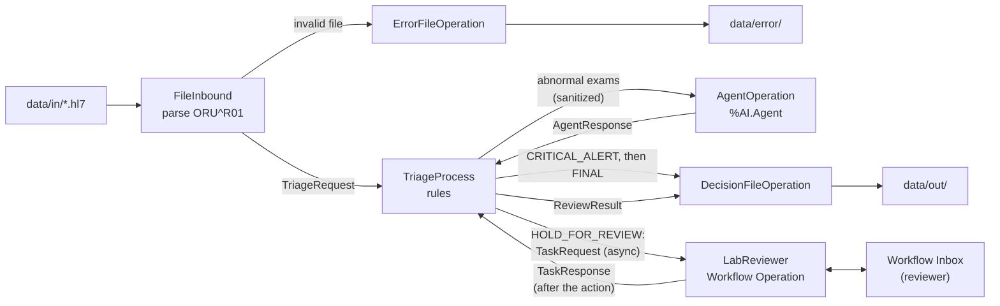

# LabTriage Agent

Entry for the InterSystems Developer Community contest **"AI Agents in Interoperability Workflows"** (2026).

Triage of HL7 v2 ORU^R01 lab results on InterSystems IRIS for Health Interoperability.
Deterministic rules decide CRITICAL. An AI agent (`%AI.Agent`, AI Hub SDK) explains the abnormal
results and decides RELEASE or HOLD_FOR_REVIEW. The most severe decision of the message wins.

All data in this repo is synthetic. The critical limits are fictional. Not for clinical use.

## Prerequisites

- Docker and Docker Compose v2.24+ (`env_file` with `required: false`)
- x86_64 host: the image is linux/amd64 only (Apple Silicon runs it emulated)
- Access to the InterSystems AI Hub Early Access Program (EAP)

## Base image

The contest rules require this base image, and no public registry has it. Load it once:

1. Download `irishealth-community-2026.3.0AI.154.0-docker.tar.gz` (x64) from the InterSystems AI Hub
   Early Access Program (EAP) portal.
2. Load and retag it:

```bash
docker image load -i irishealth-community-2026.3.0AI.154.0-docker.tar.gz
docker tag docker.iscinternal.com/docker-intersystems/intersystems/irishealth-community:2026.3.0AI.154.0 \
  irishealth-community:2026.3.0AI.154.0
```

## Quick start

```bash
git clone https://github.com/AzizCotrim/iris-lab-triage-agent.git
cd iris-lab-triage-agent
docker compose up -d --build
```

- The first build takes about 4 minutes.
- The production `LabTriage.Production` starts on its own when the container starts (1 to 2 minutes in REPLAY mode).
- `docker compose ps` shows `iris` as `healthy` once the production is running.
- You don't need a `.env` file: the default mode is REPLAY (recorded LLM answers, no API key).

## LLM provider

Gemini through the AI Hub SDK, model `gemini-3.5-flash-lite` by default.

To use the real model:

```bash
cp .env.example .env
# set GOOGLE_API_KEY=<your key> and LABTRIAGE_AGENT_MODE=REAL
docker compose up -d
```

`LABTRIAGE_MODEL` (optional) changes the model without a recompile.

Agent modes (`LabTriage.Operation.AgentOperation`):

| Mode | What it does |
|---|---|
| REAL | Calls Gemini. Records every OK answer in `data/replay/`. |
| SIMULATION | Never calls the provider. Returns the outcome in the `SimulatedOutcome` setting (`HOLD_ALL`, `RELEASE_ALL`, `TIMEOUT`, `INVALID`, ...). |
| REPLAY | Returns the answer recorded for the same prompt version and the same input. With no recording, the exams fall back to HOLD_FOR_REVIEW. |

Which mode runs: the `Mode` setting of AgentOperation, if set. Otherwise `LABTRIAGE_AGENT_MODE`. Otherwise REPLAY.

Note: REAL mode rewrites `data/replay/` on every OK answer. Run `git restore data/replay` after a REAL run.

## Verify it works

**One sample by hand:**

```bash
cp data/samples/13-critical-and-abnormal.hl7 data/in/
# a few seconds later:
ls data/out/*/
cat data/out/CRITICAL/SYN-ORU-0013.final.json
```

**All 20 samples** (needs python3). The script sets Mode=REPLAY, **deletes the files in `data/out` and `data/error`**,
drops every sample into `data/in` and checks each result (about 1 minute):

```bash
tests/e2e/samples.sh
```

**Human review** (needs python3): completes the open review tasks, then sends samples 06 and 02 through the Workflow
review (Release and KeepOnHold) and checks the tasks and the `.review.json` files (about 30 seconds). It also
**deletes the files in `data/out` and `data/error`**:

```bash
tests/e2e/workflow.sh
```

**Unit tests** (92 `%UnitTest` tests):

```bash
docker compose exec -T iris iris session IRIS -U IRISAPP <<'EOF'
Set ^UnitTestRoot="/home/irisowner/dev/tests/UnitTest"
Do ##class(%UnitTest.Manager).RunTest("LabTriage","/recursive/nodelete")
Halt
EOF
```

**Management Portal:** http://localhost:52773/csp/sys/UtilHome.csp, user `SuperUser`, password `SYS`
(local dev credentials).
Production page: http://localhost:52773/csp/healthshare/irisapp/EnsPortal.ProductionConfig.zen?PRODUCTION=LabTriage.Production

## How it works



For each exam (OBX), in this order:

1. **FileInbound** marks the exams it cannot evaluate (first problem wins). They go to review.
2. **Critical rule** (`LabTriage.Rules.CriticalLimits`): fictional limits from `LabTriage.ExamCatalog`, or a critical
   laboratory flag (HH, LL, AA). If any exam is critical, the alert file is written before the agent is called.
3. **Reference range** (OBX-7: `a-b`, `<x`, `>x`) plus the flag: normal is released, unreadable goes to review,
   abnormal goes to the agent.
4. **Agent**: one call per message for all its abnormal exams. The payload has only code, name, value, unit,
   range, flag and status: no patient identity, order or free text (`LabTriage.Util.Sanitizer`).
   `LabTriage.Util.AgentContract` validates the answer. A bad answer, timeout or provider error gets one retry.
   If there is still no valid answer, the exams go to review (fallback).

The message decision is the most severe one: **CRITICAL** > **HOLD_FOR_REVIEW** > **RELEASE**.

Supported exams: hemoglobin (718-7), glucose (2345-7), potassium (2823-3), creatinine (2160-0), sodium (2951-2).
You can edit the flag categories in the Lookup Table `LabTriage.FlagCategory` (defaults in `config/FlagCategory.xml`).

Main reason codes:

| decidedBy | reasonCode | List |
|---|---|---|
| RULE | `NORMAL` | released |
| RULE | `CRITICAL_LOW`, `CRITICAL_HIGH`, `CRITICAL_LAB_FLAG` | critical |
| RULE | `UNSUPPORTED_EXAM`, `NOT_FINAL`, `UNEXPECTED_UNIT`, `INVALID_VALUE`, `UNKNOWN_FLAG`, `UNPARSEABLE_RANGE`, `DUPLICATE_EXAM` | review |
| AGENT | `AGENT_RELEASED` / `AGENT_FLAGGED` | released / review |
| FALLBACK | `AGENT_FALLBACK` (agent failed), `PROCESSING_ERROR` (exception) | review |

Data folders (`data/`):

| Folder | Content |
|---|---|
| `in/` | Input: drop `*.hl7` files here |
| `out/` | `RELEASE/`, `HOLD_FOR_REVIEW/`, `CRITICAL/` (`<MSH-10>.final.json`), `ALERTS/` (`<MSH-10>.critical.json`) and `REVIEWED/` (`<MSH-10>.review.json`) |
| `error/` | Rejected files: a copy of the input and `<file>.error.json` |
| `archive/` | Processed input files (timestamp suffix) |
| `replay/` | Recorded LLM answers for REPLAY mode |
| `samples/` | 20 synthetic ORU^R01 test messages |

## Output

`data/out/CRITICAL/SYN-ORU-0013.final.json` (sample 13, REPLAY mode):

```json
{
  "messageControlId": "SYN-ORU-0013",
  "outputType": "FINAL",
  "orderId": "ORD-1013",
  "patientId": "SYN-000113",
  "decision": "CRITICAL",
  "released": [
    {"code": "2160-0", "name": "Creatinine", "decidedBy": "RULE", "reasonCode": "NORMAL",
     "reason": "Within reference range."}
  ],
  "review": [
    {"code": "2345-7", "name": "Glucose", "decidedBy": "AGENT", "reasonCode": "AGENT_FLAGGED",
     "reason": "Glucose is clearly outside the reference range, requiring human review."}
  ],
  "critical": [
    {"code": "2823-3", "name": "Potassium", "decidedBy": "RULE", "reasonCode": "CRITICAL_HIGH",
     "reason": "Potassium 6.8 mmol/L is above the critical high limit of 6.2 mmol/L (fictional limit)."}
  ],
  "agent": {"called": true, "attempts": 1, "status": "OK", "latencyMs": 0,
            "provider": "replay", "model": "gemini-3.5-flash-lite"},
  "emittedAt": "2026-10-31T11:34:13.116Z"
}
```

`data/out/ALERTS/SYN-ORU-0013.critical.json` has the same shape, with `"outputType": "CRITICAL_ALERT"` and only the
critical list. All times are UTC.

`data/error/10-malformed-no-obx.hl7.error.json`:

```json
{
  "sourceFileName": "10-malformed-no-obx.hl7",
  "reason": "The message has no OBX segment.",
  "messageControlId": "SYN-ORU-0010",
  "patientId": "SYN-000110",
  "receivedAt": "2026-10-31T11:34:09Z"
}
```

## Human review (Workflow)

A message whose **final decision is HOLD_FOR_REVIEW** also becomes a task in the Workflow Inbox, for the
`LabReviewer` role. This includes the agent fallback (no valid answer from the agent). CRITICAL messages don't get a
task: the alert file is their escalation. RELEASE messages need no human.

- Inbox: http://localhost:52773/csp/healthshare/irisapp/_DeepSee.UserPortal.Workflow.zen, user `SuperUser`,
  password `SYS`. The Inbox shows the tasks of the logged-in user only. `iris.script` creates the Workflow users
  `SuperUser` and `_SYSTEM` at build time and adds both to `LabReviewer`, so each task reaches both of them.
- The task subject is `Lab results held for review: MSH-10 <MSH-10>, order <OBR-2>`. The message lists the exams held
  for review, with their reasonCode and reason.

To review a task:

1. Open the task in the Inbox.
2. Click **Accept**. The task is now yours (the other user can no longer act on it).
3. Click **Release** or **KeepOnHold**.

The action goes to `data/out/REVIEWED/<MSH-10>.review.json` (sample 06, Release):

```json
{
  "messageControlId": "SYN-ORU-0006",
  "outputType": "REVIEW",
  "orderId": "ORD-1006",
  "patientId": "SYN-000106",
  "action": "Release",
  "reviewer": "SuperUser",
  "role": "LabReviewer",
  "taskCreatedAt": "2026-11-01T13:11:55.082Z",
  "taskCompletedAt": "2026-11-01T13:11:58.836Z",
  "emittedAt": "2026-11-01T13:11:58.837Z"
}
```

After `tests/e2e/samples.sh`, the Inbox has one task per HOLD_FOR_REVIEW sample (10 tasks), ready to review.
The next run of `tests/e2e/samples.sh` or `tests/e2e/workflow.sh` first completes with Release the tasks still open
(`tests/e2e/drain-review-tasks.sh`), so their `.review.json` files are written and then deleted with the rest of
`data/out`.

The file name rules are the same as for `.final.json`: safe characters only, and a timestamp suffix for a repeated MSH-10.

The review never blocks or changes the triage. The `.final.json` is written right away, and the review is one more
event later, in its own file. The `.final.json` stays as it was.

The call is asynchronous: the Workflow Operation (`EnsLib.Workflow.Operation`) defers its response (DeferResponse)
until a reviewer acts, however long that takes. The TriageProcess sends the task with `SendRequestAsync` and writes the
`ReviewResult` in `OnResponse`. If the task cannot be created (`OnError`), the process only logs a warning.

## Known limitations

- Reference ranges with a negative lower bound (e.g. `-1-5`) are not parsed (UNPARSEABLE_RANGE).
- The agent contract validates the structure of the answer, not the medical content of `reason`.
- If an exception happens before the critical rule evaluates an exam, that exam goes to review, not CRITICAL.
- MSH-10, PID-3 or OBR-2 longer than 255 characters are rejected.
- The same rejected file name twice overwrites the previous `.error.json`.
- REPLAY only has recordings for the abnormal exams of the samples; any other abnormal input falls back to HOLD_FOR_REVIEW.
- `data/in`, `out`, `error`, `archive` and `replay` are chmod 0777 by the `init-perms` service (local demo, synthetic data).
- Lookup Table edits made in the Management Portal are lost when the container is recreated: the table is
  reloaded from `config/FlagCategory.xml` at build time.
- The IRIS instance status shows "alert" because of startup errors in the EAP build
  (`<METHOD DOES NOT EXIST>Sharding+2^STU`, "System appears to have failed over from node buildkitsandbox").
  The compose healthcheck reports the production state instead.
- Review tasks have no timeout or expiration: a task stays open until a reviewer acts on it.
- Each open review task keeps one TriageProcess instance persisted and waiting for the answer.
- The Inbox action buttons are disabled while the production is stopped.
- The Priority column of the Inbox is empty for the review tasks (cause not investigated).
- linux/amd64 only.

## Tests

| Test | What it checks |
|---|---|
| `%UnitTest` classes in `tests/UnitTest/` | 92 tests: CriticalLimits (31), ReferenceRange (23), AgentContract (31), DecisionFileOperation (7: review file, names, timestamps) |
| `tests/e2e/samples.sh` | The 20 samples in REPLAY: folder, decision, agent, reasonCode per exam, alert, error files. Leaves one open review task per HOLD_FOR_REVIEW sample |
| `tests/e2e/workflow.sh` | Workflow review of samples 06 (Release) and 02 (KeepOnHold): task in the Worklist, role users, Accept and action as SuperUser, `.review.json` |
| `tests/e2e/drain-review-tasks.sh` | Helper: completes every open review task (default action Release), as the Inbox does |
| `tests/e2e/agent-simulation.sh` | Sample 03 through 8 simulated agent outcomes (retry, fallback, fenced JSON) |
| `tests/e2e/clean-clone-check.sh` | A clean clone of HEAD without `.env`: build, production running, healthy, folder permissions, `samples.sh`, `workflow.sh` |

The e2e scripts need the `iris` service up. They change the AgentOperation `Mode` on the running production and set it
back to empty at the end. `clean-clone-check.sh` stops this repo's stack first and does not restart it.

## Project structure

```
├── Dockerfile, docker-compose.yml, iris.script, merge.cpf
├── .env.example
├── config/FlagCategory.xml        flag -> NORMAL / ABNORMAL / CRITICAL defaults
├── data/                          in, out, error, archive, replay, samples
├── docs/dev-journal.md            what was built and observed, day by day
├── src/LabTriage/
│   ├── Production.cls
│   ├── Service/FileInbound.cls
│   ├── Process/TriageProcess.cls
│   ├── Operation/                 AgentOperation, DecisionFileOperation, ErrorFileOperation
│   ├── Agent/TriageAgent.cls      %AI.Agent subclass: prompt, provider, model
│   ├── Rules/CriticalLimits.cls
│   ├── Util/                      ReferenceRange, AgentContract, Sanitizer, FlagTable
│   ├── ExamCatalog.cls
│   └── Msg/                       message classes
└── tests/                         UnitTest/ and e2e/
```

## License

MIT, see [LICENSE](LICENSE).